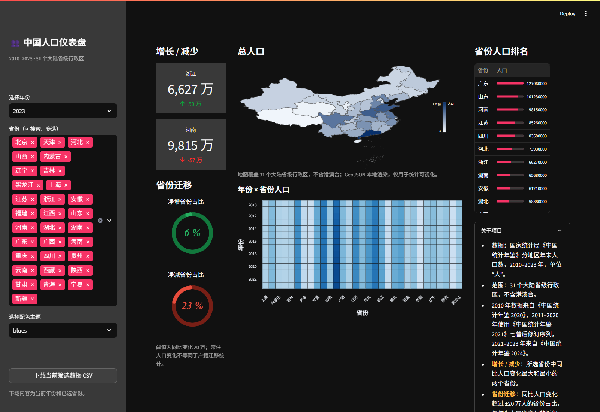

# 中国人口仪表盘

基于 [dataprofessor/population-dashboard](https://github.com/dataprofessor/population-dashboard) fork 改造的中国省级人口数据仪表盘，使用 Streamlit、pandas、Altair 和本地 GeoJSON 构建。

原项目是一个使用 Python + Streamlit 的人口仪表盘模板；本仓库保留其视觉基础和原作者署名，数据、地图、指标与交互均已替换为中国大陆 31 个省级行政区。

在线演示：[china-population-dashboard.streamlit.app](https://china-population-dashboard.streamlit.app/)



## 项目内容

- 数据覆盖：2010–2023 年，31 个大陆省级行政区（不含港澳台），年末常住人口，单位为“人”。
- 交互：年份选择、省份搜索/多选、10 套配色主题、当前筛选 CSV 下载。
- 主面板：增长/减少、省份迁移环形图、中国省级 choropleth、年份 × 省份热力图、省份人口排名。
- 单省趋势：只选择一个省份时显示该省 2010–2023 年人口折线图。
- 深色主题和原版三列布局保持不变。

## 数据来源与覆盖范围

数据来自国家统计局《中国统计年鉴》的分地区年末人口数。原始表格单位为“万人”，构建时统一乘以 10,000 转为“人”。

| 年份 | 年鉴来源 | 原始表 |
| --- | --- | --- |
| 2010 | [《中国统计年鉴 2020》](https://www.stats.gov.cn/sj/ndsj/2020/indexch.htm) | [表 2-6](https://www.stats.gov.cn/sj/ndsj/2020/html/C0206.jpg) |
| 2011–2020 | [《中国统计年鉴 2021》](https://www.stats.gov.cn/sj/ndsj/2021/indexch.htm) | [表 2-5](https://www.stats.gov.cn/sj/ndsj/2021/html/C02-05.jpg) |
| 2021–2023 | [《中国统计年鉴 2024》](https://www.stats.gov.cn/sj/ndsj/2024/indexch.htm) | [表 2-5](https://www.stats.gov.cn/sj/ndsj/2024/html/C02-05.jpg) |

2011–2020 使用《中国统计年鉴 2021》的七普后修订序列；2021–2023 使用《中国统计年鉴 2024》。2014–2020 在两本年鉴中重叠，构建脚本会交叉校验这些年份。

数据文件：

- 最终数据：`data/china-population-2010-2023-reshaped.csv`
- 省级代码与短名/全名映射：`data/china-provinces.csv`
- 原始年鉴图片：`data/raw/source_images/`
- 原始转录 CSV：`data/raw/nbs-2020-table2-6.csv`、`data/raw/nbs-2021-table2-5.csv`、`data/raw/nbs-2024-table2-5.csv`
- 来源清单：`data/raw/source_manifest.json`

最终数据字段与原版逻辑对齐：

```text
year, provinces, provinces_code, population, id
```

`provinces_code` 使用六位统计用区划代码；`id` 在映射表中保持稳定。

## 数据处理与校验

构建脚本：

```powershell
.\.venv\Scripts\python.exe -X utf8 data\build_china_population.py
```

校验脚本：

```powershell
.\.venv\Scripts\python.exe -X utf8 data\validate_china_population.py
```

当前校验结果：

- 434 行 = 2010–2023 年 × 31 个省级行政区；
- 每年恰好 31 个省份；
- 人口全部为正数，且为 1 万人的整数倍；
- 分省合计与全国总数的偏差范围为 0.1402%–0.5265%，全部低于 0.75% 的校验上限；
- 2014–2020 年两本年鉴的重叠数据完全一致。

## 地图方案

地图使用本地 GeoJSON 驱动，不需要运行时访问地图 CDN：

- 来源：[阿里云 DataV.GeoAtlas 中国省级 GeoJSON](https://geo.datav.aliyun.com/areas_v3/bound/100000_full.json)
- 原始文件：`data/raw/geojson/100000_full.json`（35 个 feature）
- 裁剪结果：`data/china-provinces.geojson`（31 个省级 feature）
- 构建脚本：`data/build_geojson.py`
- 来源与 SHA256：`data/raw/geojson_source_manifest.json`

原始 GeoJSON 中的台湾、香港、澳门和非省级 feature 会被排除，以保持与人口数据的 31 个省级行政区一致。地图几何只用于统计可视化，不作为行政区划或边界依据。

地图渲染位于 `dashboard/choropleth.py`，使用本地 GeoJSON 生成 SVG choropleth。这样即使部署环境无法访问 `cdn.plot.ly`，地图也不会变成空白；省份筛选后未选省份会以灰色显示。

## 项目结构

```text
streamlit_app.py                 Streamlit 入口和页面布局
dashboard/charts.py              Altair 热力图、环形图、趋势图
dashboard/choropleth.py          本地 GeoJSON → SVG 中国省级地图
dashboard/data.py                数据加载、校验、筛选、同比、导出
dashboard/formatting.py          人/万/亿格式化
data/build_china_population.py   年鉴原始 CSV → reshaped CSV
data/validate_china_population.py 数据校验
data/build_geojson.py            GeoJSON 裁剪和校验
tests/test_dashboard.py          unittest 测试
docs/verification/               本地与线上验收截图
```

## 指标说明

- **增长/减少**：在所选省份中，计算当年相对上一年的常住人口变化，取最大和最小的省份。
- **省份迁移**：统计同比变化大于 +200,000 或小于 -200,000 的省份占已选省份的比例。阈值为常住人口净变化的近似观察，不等同于户籍迁移统计。
- **2010 年**：没有上年可比数据，增长/减少显示 `-`，迁移环形图显示 0%。
- **2023 年净减 7 个省份**：按最终 ±20 万阈值，名单为重庆、河北、甘肃、湖南、黑龙江、山东、河南。计划阶段初算的 4 个对应更严格的 -30 万口径（湖南、黑龙江、山东、河南）；v1 为贴近省级年度变化分布将阈值定为 ±20 万，因此名单扩大了 3 个省份。
- **下载文件**：文件名为 `china-population-<年份>.csv`。文件名只标识年份，不包含省份列表；文件内容始终是“当前年份 + 当前已选省份”的筛选结果，改变省份选择会改变内容但不会改变文件名。

## 本地运行

建议使用 Python 3.13，并在项目目录创建独立虚拟环境：

```powershell
python -m venv .venv
.\.venv\Scripts\Activate.ps1
python -m pip install -r requirements.txt
streamlit run streamlit_app.py
```

依赖已锁定为：

```text
streamlit==1.41.1
pandas==2.2.3
altair==5.5.0
plotly==5.24.1
```

运行测试：

```powershell
.\.venv\Scripts\python.exe -X utf8 -m unittest discover -s tests -v
```

## Streamlit Community Cloud 部署

当前线上地址：[https://china-population-dashboard.streamlit.app/](https://china-population-dashboard.streamlit.app/)

部署配置：

- Repository：`bowenren-Andrew/china-population-dashboard`
- Branch：`master`
- Main file path：`streamlit_app.py`
- Python：`3.13`
- Secrets：不需要；应用只读取仓库内的 CSV 和 GeoJSON

如需从 fork 重新创建应用：

1. 在 Streamlit Community Cloud 选择 **New app**。
2. 填写上述 Repository、Branch 和 Main file path。
3. 在 Advanced settings 中选择 Python 3.13。
4. 不需要填写 Secrets，点击 Deploy。

线上验收截图见 `docs/verification/06-streamlit-live.png` 和 `docs/verification/07-streamlit-province-trend.png`。已验证首页地图有 31 个省级路径、热力图和环形图非空、年份/省份筛选可切换、配色主题可切换、CSV 下载可用，页面无 Streamlit 异常。

## 原项目与署名

- 原项目：[dataprofessor/population-dashboard](https://github.com/dataprofessor/population-dashboard)
- 原作者：Chanin Nantasenamat（GitHub: [@dataprofessor](https://github.com/dataprofessor)）
- 原项目演示：[population-dashboard.streamlit.app](https://population-dashboard.streamlit.app/)
- 原项目说明：A dashboard web app template built in Python using Streamlit。
- 本仓库是基于原项目 fork 改造的版本，不是从零原创项目。原仓库根目录在 2026-11-11 没有 `LICENSE` 文件；本仓库不主张重新授权原项目代码。

## v2 范围

以下内容明确不在 v1：

- 300+ 地市级数据；
- 用户上传 CSV；
- 登录、后端 API；
- 中英文切换；
- 移动端专项适配。

## 数据限制

- 2010 年分省合计与全国总数存在约 0.53% 差额；这是年鉴口径差异，不是补数或插值造成的。
- 人口变化是年末常住人口净变化，不能直接解释为迁入/迁出人数。
- 地图边界来自第三方公开 GeoJSON，仅用于统计可视化。
- 港澳台不在本版数据范围。
